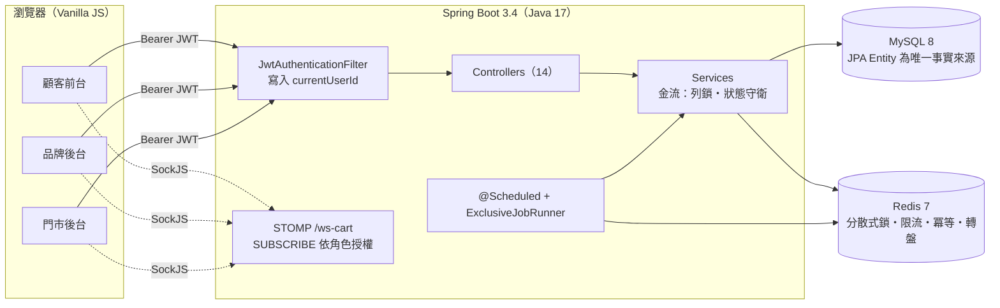
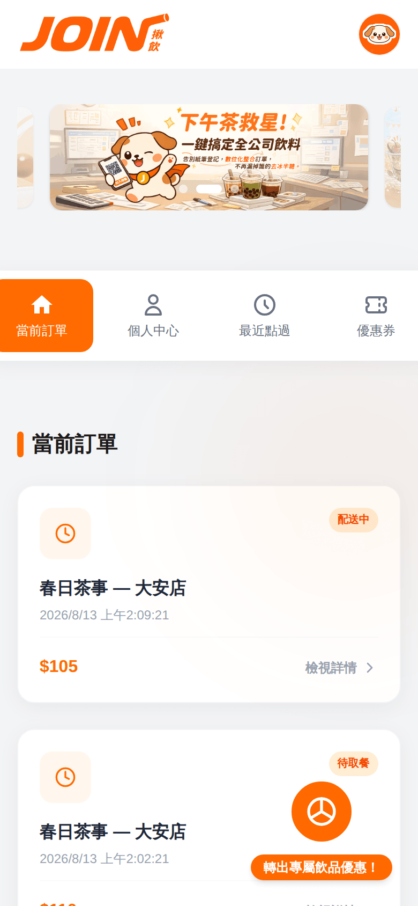
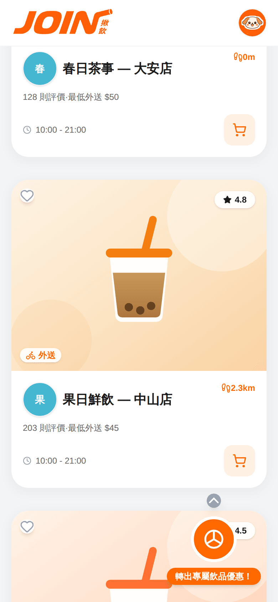
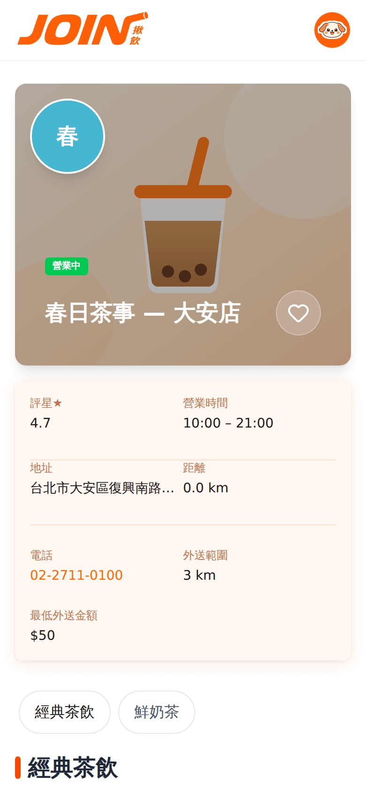
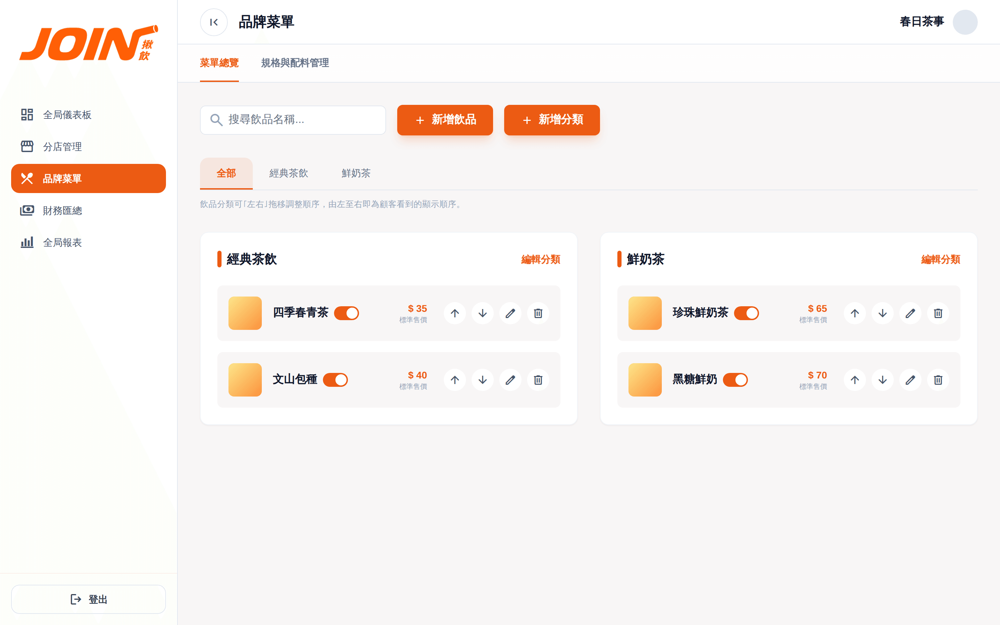
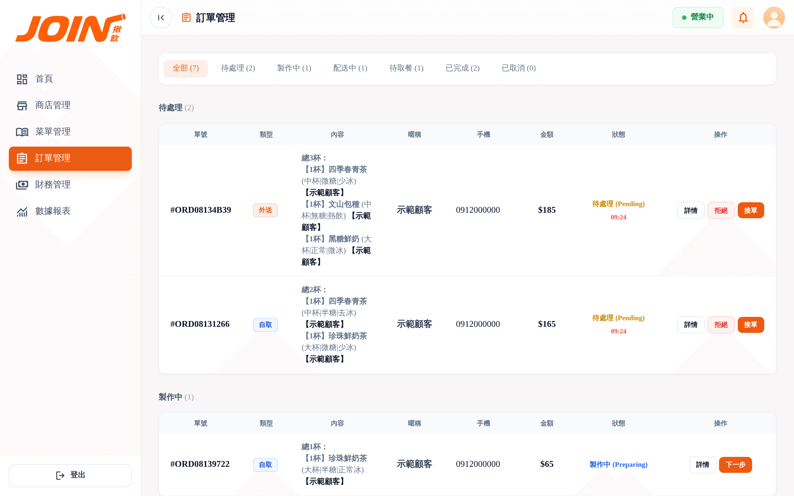

# JoinDrink

多租戶飲料訂購與**揪團**平台。顧客可以自己下單，也可以開一個揪團連結讓同事朋友各自加點、由團長統一結帳；
品牌總部管理菜單與跨店財務，門市端處理接單與庫存。

**Spring Boot 3.4.3 / Java 17 · MySQL 8 · Redis 7 · WebSocket(STOMP) · JWT**

[](https://github.com/Leo0049/projectLab_2/actions/workflows/ci.yml)

---

## 文件導覽

JoinDrink 是以 Spring Boot 實作的多租戶飲料訂購與揪團平台，有顧客、品牌總部、門市三種角色。
本專案的重心是 **金流與授權的正確性**。兩次安全審查與併發實測找出的問題都已修補，並寫成可重跑的測試；每個取捨都記錄在決策文件中。

**建議閱讀順序**

1. [問題紀錄](docs/ISSUE_LOG.md)：十個實際遇到的工程問題，每個都有症狀、根因、修法與防止再發生的方式。
2. [架構決策紀錄（ADR）](docs/adr/README.md)：金流列鎖、授權白名單、IP 信任邊界、冪等結帳、Redis 與排程互斥，以及明確延後的事項。
3. [優化建議實作評估](docs/IMPROVEMENT_ASSESSMENT.md)：20 項建議的逐項決策，包含沒做的部分與理由。
4. [API 文件](API.md)、[資料庫說明](DATABASE.md)、[部署指南](docs/DEPLOYMENT.md)。



**三層驗證，全部在 CI 上跑**

| 層 | 內容 | 守住的東西 |
|----|------|-----------|
| 0. 靜態檢查 | gitleaks secret 掃描；受版控 JS 的 `node --check`；HTML 內嵌 script 的語法檢查 | 金鑰外洩、前端語法錯誤 |
| 1. 單元與整合測試 | `mvn test`：390 個 `@Test`，68 個測試類別（JUnit 5 + Mockito；10 個類別載入 Spring context）；JaCoCo 報告（不設門檻） | 授權、金流併發、帳號驗證、規則的回歸 |
| 2. API 端對端 | `scripts/e2e-verify.js` 直接打後端，含冪等結帳的重送與轉盤 409 | 端點契約、交易邊界、序列化 |
| 3. UI 流程 | `scripts/ui/run-all.js`（Playwright，斷網模式）：41 個 HTML 頁面全數普掃（共 53 次載入，顧客主頁有資料與空狀態各掃一次；管理員後台兩頁），加上點餐、轉盤、揪團、搜尋分頁四條主線與管理員審核 | 只有真的載入畫面、真的按下去才會出現的問題 |

此外，CI 會以 `docker build` 驗證 Dockerfile 能建成映像（只建置、不推送）。

**誠實的限制**

- JWT 存於 `localStorage`，CSP 預設關閉。改為 httpOnly cookie 與強制 CSP 需要先外部化大量 inline handler，已列為延後事項（[ADR-0007](docs/adr/0007-deferred-decisions.md)）。
- 沒有 schema 遷移工具，結構由 `ddl-auto: update` 管理。正式上線前要導入 Flyway（[ADR-0008](docs/adr/0008-schema-migrations.md)）。
- WebSocket 目前是單實例的 simple broker；Redis 不可用時，鎖與限流會退回單實例語意（[ADR-0006](docs/adr/0006-redis-shared-state-and-job-exclusion.md)）。
- 前端有 16 處寫死 `http://localhost:8082`（`window.JOIN_API_BASE` 與各頁面、各 JS 模組的 `BASE` 常數）。本機與 Docker 展示不受影響；要做公開 demo 前，需先改為設定值或同源反向代理。
- 文件中的所有測試與效能敘述，以 CI 為準。開發環境無法連到 Maven Central 且沒有 Docker，因此 Java 編譯、`mvn test`、Spring 整合測試與瀏覽器 E2E 都在 GitHub Actions 上執行；結果見下方「程式與測試的最後一次 CI 驗證」。

---

## 30 秒把它跑起來

```bash
docker compose up -d      # MySQL 8 + Redis 7
mvn spring-boot:run       # 服務起在 :8082
```

不需要任何額外設定：`application.yml` 每一項都有對應本機 Docker 的預設值，
首次啟動會自動建表並植入**示範資料**（2 個品牌、3 間門市、6 款飲品、1 個顧客帳號，
以及 7 筆訂單，涵蓋待處理、製作中、待取餐、已完成四種狀態，讓門市後台一開就有東西可看）。

開 http://localhost:8082/swagger-ui.html 看 API，或用下列帳號登入前端頁面
（`frontend/` 為靜態頁，用 VS Code Live Server 之類的工具開啟即可）：

| 角色 | 帳號 | 密碼 |
|------|------|------|
| 顧客 | `0912000000` | `demo1234` |
| 品牌總部 | `demo_brand` | `demo1234` |
| 門市 | `demo_store` | `demo1234` |

> 示範資料只在資料表為空時植入，不會覆蓋既有資料；正式環境請設 `DEMO_DATA_ENABLED=false`。

**要現場演示的話，開始前先跑一次 `./scripts/demo-reset.sh`**（清空並重新植入，實測 13 秒）。
原因是有兩個功能會隨時間失效：門市首頁「待處理」的訂單有 **10 分鐘倒數**，時間到時若頁面仍開著，前端會自動送出拒單（伺服器端沒有排程，見「已知技術債」）——
服務開著講了十幾分鐘架構之後才打開後台，接單／拒單那段就沒東西可以示範了；
每日轉盤則是**一個帳號一天只能抽一次**，彩排抽過，正式演示就只會看到「你今日已參加過」。

演示不需要網路：Tailwind、Leaflet、Lucide、Chart.js、SockJS/STOMP、QRCode 與三套圖示字型
都收在 `frontend/vendor/`（3.3 MB，用 `./scripts/vendor-assets.sh` 可重新抓取）。
仍需連外的只剩地圖圖磚、地址搜尋與社群登入這三個本質上是線上服務的東西。

⚠️ 前端請用**靜態伺服器**開啟，不要直接雙擊 HTML 檔（`file://` 的 Origin 是 `null`，會被 CORS 擋掉）。
VS Code Live Server 的預設埠是 5500，但 5500 被占用時它會**靜默改用 5501**；
預設白名單為 `localhost:5173`、`localhost:5500`、`127.0.0.1:5500`、`localhost:8082`、`127.0.0.1:8082`（與 `application.yml` 一致）。若 Live Server 改用其他埠，請改用固定埠，或把來源加到 `application-local.yml`，或設定 `CORS_ALLOWED_ORIGINS`。

---

## 功能範圍

| 模組 | 內容 |
|------|------|
| **揪團訂單** | 建立揪團 → 產生分享 token → 成員各自加點 → 團長統一送出、補款/退款 |
| **錢包與帳本** | 儲值、下單扣款、團長代墊託管、取消／拒單退款、團員補款，全部進同一份帳本 |
| **多租戶菜單** | 品牌層級的飲品模板、甜度/冰量/杯型規格、加料設定，門市可覆蓋供應狀態 |
| **區域定價** | 同品牌不同地區可設定各自的分類加價 |
| **即時推播** | WebSocket/STOMP 推送訂單狀態與揪團品項異動 |
| **優惠券轉盤** | 每日抽獎，優惠券圖片由 Java 2D 動態生成後上傳 Cloudinary |
| **商品快照** | 下單時保存當下品名與價格，日後改價不影響歷史訂單 |

規模：後端 159 個 Java 檔案 / 約 17.6k 行（`src/main/java`），26 張資料表，14 個 REST controller；前端 41 個頁面、約 18.8k 行 JS（不含 `vendor/`；Vanilla JS + Tailwind）。

---

## 畫面

以下都是照著「30 秒把它跑起來」啟動後的實際畫面，資料來自內建示範資料，沒有另外做假圖。

| 顧客首頁 | 附近店家 | 店家與菜單 |
|---|---|---|
|  |  |  |
| 進行中訂單、活動輪播、每日轉盤入口 | 依距離排序，含評分、外送門檻與營業時間 | 店家資訊與分類菜單 |

| 品牌總部 — 菜單管理 | 門市後台 — 訂單管理 |
|---|---|
|  |  |
| 分類與飲品排序、上下架、售價維護 | 依狀態分區，接單／拒單／製作完成的完整流轉 |

> 店家與飲品圖片是專案內建的 SVG 示意圖，第三方函式庫也全部收在 `frontend/vendor/`，
> **整個前端在斷網狀態下畫面完全正常**（CI 固定用斷網模式跑普掃與四條主線）。

---

## 架構

```
Customer / Brand / Store 三種前台 (Vanilla JS)
                │  Bearer JWT
                ▼
      ┌──────────────────────┐
      │  Spring Security 6   │  JwtAuthenticationFilter → currentUserId
      │  + STOMP 攔截器       │  CONNECT 驗 JWT、SUBSCRIBE 驗訂單關係人
      └──────────┬───────────┘
                 ▼
   14 Controllers → Services → 28 Repositories
                 │                      │
                 ▼                      ▼
          Redis 7                   MySQL 8
   揪團購物車 / 分散式鎖 / 轉盤狀態      26 張表（JPA Entity 為 schema 唯一事實來源）
```

三種角色 `CUSTOMER` / `BRAND` / `STORE`，授權規則集中在 `SecurityConfig`。

---

## 安全稽核與修補

專案完成後對**執行中的系統**做了一輪黑箱與白箱並行的稽核，
所有問題都以實際請求重現、並用資料庫狀態確認，修補後再重跑同一組驗證。

| # | 問題 | 實測影響 | 修補 |
|---|------|---------|------|
| S-1 | `POST /api/products` 落在整段 `permitAll`，且直接綁定 JPA 實體 | 未登入即可新增商品；因 `save()` 的 merge 語意帶入既有 `id` 可竄改他人商品，**實測把售價 65.00 改成 0.01** | 移除該冗餘端點；`permitAll` 一律改為只放行 `HttpMethod.GET` 的具體路徑 |
| S-2 | 擁有權檢查寫成 `if (authUserId != null && ...)`，而 `authUserId` 是用戶端自送的選填參數 | 不帶該參數即可跳過檢查，**實測把他人餘額改成 99999** | 改用 filter 注入的 `currentUserId`，10 個端點統一走 `requireSelf()` |
| S-3 | 同一成因造成一批讀取端點缺少擁有權檢查 | 可讀取他人姓名、手機號碼與餘額 | 同上 |
| S-4 | 兩個 debug 端點位於 `permitAll` 路徑下 | 未認證即可取得他人手機號碼；另一支會回傳完整 stack trace | 移除 |
| S-5 | WebSocket 為 `allowedOriginPatterns("*")` 且無任何 STOMP 攔截器 | `orderId` 是連續整數可列舉，任何人可旁觀他人訂單狀態 | CONNECT 驗 JWT、SUBSCRIBE 驗訂單關係人；origin 收斂為與 HTTP 共用的白名單 |
| S-6 | `OrderController` 整支沒有任何擁有權檢查：訂單列表吃路徑上的 `userId`，狀態／取消端點則是 `if (userId != null) 檢查 else 放行` | 任一登入顧客可讀他人完整訂單歷史（金額、品項、揪團 `shareToken`）；**不帶 `userId` 參數即可把他人訂單從 READY 改成 COMPLETED**；`/api/orders/store/{id}` 還能撈出整間門市訂單，含其他顧客的外送地址 | 全部改用 filter 注入的 `currentUserId`，移除「不帶參數就跳過」的分支；門市傾印端點刪除（門市請用有分頁、有 STORE 權限的 `/api/stores/orders`） |
| D-1 | 餘額為「讀出→相加→寫回」且無列鎖 | 20 個併發各儲值 10 元，**最終只入帳 70 元，且帳本總額 120 與餘額 70 對不起來** | 改用 `SELECT ... FOR UPDATE`；所有金流都收斂在 `updateStoreCredit()` 一個進入點 |
| D-4 | 優惠券的消耗是「先讀出檢查 `status == unused`，再寫回 `used`」的 read-check-write | 兩個品項同時套用同一張券，**兩邊都拿到折扣**——一張券折了兩次 | 改為原子的 `UPDATE ... WHERE status = 'unused'`，受影響列數為 0 即代表已被用掉並擋下；且在動品項**之前**先消耗 |
| D-2 | 四條金流路徑都是「讀出品項 → 動錢 → 改狀態」的 read-modify-write，全部沒有列鎖 | 以 8 個併發請求實測（金額都應該只發生一次 $35）：<br>團員結帳 → 帳本 5 筆 −35（−175）而餘額只掉 35，**差 5 倍**<br>團長結帳 → 8 個全部成功，**被扣 8 次**<br>補款給團長 → **扣了 175**<br>取消退款 → escrow **退了 280** | 品項與揪團該列一律改用 `PESSIMISTIC_WRITE` 鎖定讀（`findByGroupOrderAndUserAndStatusForUpdate` / `findByShareTokenForUpdate` / `findByIdForUpdate`），結帳另加狀態守衛 |
| S-7 | `POST /api/orders/checkout`（顧客結帳頁真正打的端點）身分與成交價**都取自 request body** | 把 `userId` 換成別人的即可**拿他人錢包付自己的訂單**（實測受害者餘額 19255 → 19220，攻擊者餘額 0 不變）；把 `finalPrice` 送成 1 則能**用 $1 買走 $35 的飲料** | 身分改用 filter 注入的 `currentUserId`（連同 `saveOrUpdateUserAddress` 一起）；金額改由 `OrderService.repriceItems()` 依資料庫重算，公式收斂到 `PricingService`（底價＋區域加價＋配料加價），快照欄位一律由伺服器決定 |
| S-8 | `UserFavoriteController` 三支端點的 userId 分別取自路徑、查詢參數與 request body，全都沒有擁有權檢查 | 任一登入顧客可讀取他人的收藏清單、查詢他人是否收藏某店，並用他人的 `userId` 呼叫 toggle——**實測把受害者收藏的店家直接取消掉** | 三支一律改用 filter 注入的 `currentUserId`，讀取端點加 `requireSelf()` |
| S-9 | 消耗優惠券的 `UPDATE` 只比對 `id` 與 `status`，沒有比對擁有者；`apply-coupon` 端點又完全不看 token；`GET /api/coupons/user/{userId}` 與 `/{id}` 也沒有擁有權檢查 | `user_coupons.id` 是連續整數，**實測把受害者的 couponId 套到自己的品項上：對方的券變成 `used`，折扣算在攻擊者頭上**（偷券）| 擁有者一併寫進 `WHERE`（與狀態同一個原子操作）；三支端點的身分一律改取自 token，單張查詢的擁有權檢查放在 Service 的交易內 |
| D-5 | 評分流程先 insert `order_ratings`（外鍵在 `stores` 那列加共享鎖）再 update 該列的 `avg_rating`／`review_count`（要升級成排他鎖），且彙總是在 Java 端 COUNT 完再寫回 | **12 個併發評分只有 2 筆成功，其餘 10 筆全部死鎖失敗**；把死鎖排除後又換成算錯——12 筆評分寫進去了，門市顯示的則數卻只有 4、平均分數差了 0.1（COUNT 讀的是本交易的快照）| 先取門市列的排他鎖再寫評分（`StoreRepository.findByIdForUpdate`），讓後到的交易排隊而不是形成死結；彙總改用單一 SQL `UPDATE ... (SELECT COUNT/AVG ...)`，子查詢讀的是最新已提交版本而非快照 |
| D-3 | `findByIdForUpdate` 取得了列鎖，回傳的卻是一級快取裡「上鎖之前」的 User | 呼叫端只要在扣款前讀過同一個 User（揪團結帳會先碰 `item.getUser()`），列鎖就被架空，併發時每個交易用同一個舊餘額計算，最後一個寫入獲勝 | 在持鎖狀態下以 `refresh(user, PESSIMISTIC_WRITE)` 重讀。**不能用普通 `refresh()`**：MySQL 預設 REPEATABLE READ 之下普通 SELECT 讀的是交易快照，回來還是舊值——這一版修補是被測試打回來才改對的 |

| S-10 | JWT 濾器只查 CUSTOMER 是否仍有效，BRAND／STORE 則只信任 token 內的角色與 ID | 若品牌或門市帳號資料列被刪除，既有 token 在到期前仍可通過驗證 | 每個角色都查核對應帳號是否存在；CUSTOMER 仍同時檢查軟刪除狀態 |
| S-11 | 品牌後台將門市、分類、商品、規格與報表名稱直接插入 HTML 字串 | 被儲存的名稱或錯誤訊息可能被瀏覽器當成標記執行 | 文字改用 `textContent`／DOM 屬性，保留字串模板的地方先做完整 HTML 跳逸；CSP 仍依安全文件的路線圖分階段導入 |

另外修掉幾個會直接影響可用性的問題：

- **登入必定 500**：`signWith(alg, String)` 會將 secret 做 Base64 解碼，預設值解碼後只剩 416 bits，不符 HS512 要求。改用原始位元組建立金鑰，並把長度檢查移到啟動時，不足即啟動失敗。
- **`jwt.expiration` 完全不生效**：`JwtUtils` 寫死 7 天，設定檔的 24h 從未套用。
- **用戶端錯誤一律回 500**：路由不存在、缺參數、型別錯全部落入 catch-all；且原始例外訊息（含 DB 結構）會回傳給前端。現已分流為 404/400/405，內部細節只寫入 log。
- **`open-in-view: false` 之下的固定 500**：關閉 OSIV 後，交易外碰到 LAZY 關聯就會拋 `LazyInitializationException`。這類錯誤在單元測試看不到、要實際打端點才會現形，前後踩過九次（歸納為四種型態，見 CLAUDE.md）——其中 `GET /api/stores/settings/profile` 是門市後台**每一頁的頁首**都會呼叫的，壞掉時整個後台的營業狀態永遠停在「讀取中…」。另兩個公開端點直接回傳 JPA entity，Jackson 序列化 `brand` / `region` proxy 時必定 500。修法統一為「在交易內轉成純 Map 再回傳」，這類問題只有實際打端點才會現形，因此改動序列化或關聯的程式碼後，應重跑 GET 端點的普掃（做法見 CLAUDE.md）。

帳本本身也整理過。`transaction_records.type` 一度被當成顯示字串，實際存的是
`"消費扣款\n個人訂單 #12 結帳扣款"` 這種兩行文字，前端再自己 split、用 `includes('補款')`
之類的比對推回種類——連「按種類統計」都得寫 `SUBSTRING_INDEX(type,'\n',1)`。
現已拆成 `type`（固定 token）與 `description`（說明）兩欄，判斷邏輯收在純函式
`TxDisplay.normalize()`（舊資料照樣拆得回來），前端只負責畫。
順帶修掉兩個對帳上的小洞：扣款發生在訂單 persist 之前，說明固定寫成「個人訂單 # 結帳扣款」，
**52 筆全都對不回是哪一張單**；以及 `GET /api/wallet/transactions` 把整份帳本撈進記憶體再
`subList` 切頁——查十筆卻讀了全部，和 `/api/stores/orders` 當初那個問題一模一樣。

演示前也照著「第一次 clone 下來」的路徑實跑過一遍（清空資料庫 → 冷啟動 → 三條主線），
又抓到三個只在演示情境才會出事的問題：

- **示範資料會憑空生錢**：`DemoDataSeeder` 直接 `setBalance(500)`，示範訂單卻各自帶著
  `escrow_amount` 而沒有對應的扣款紀錄。那些待處理訂單超過 10 分鐘會自動取消，
  退款邏輯就把「從來沒扣過的錢」退還——**實測餘額憑空從 500 跳到 850**，
  而帳本總額是 −175，兩邊對不起來。現在餘額用帳本灌、示範訂單也真的走一次扣款，
  重置後餘額 1130 與帳本總額 1130 完全相等。
- **CORS 只放行 5500**：VS Code Live Server 預設是 5500，但 5500 被占用時會**靜默改用 5501**，
  此時整個前端因為 preflight 被擋而全部失效（實測 5501／3000／8080／`file://` 都是 403）。
  修法是讓 Live Server 使用固定埠，並把實際用到的來源寫進 `application-local.yml`（範本見 `application-local.yml.example`）。預設白名單不再為個別 IDE 的臨時埠放寬。
- **「今天已經抽過」回 500**：那是正常的使用者情境，不是系統錯誤。演示時第二次點轉盤，
  devtools 會出現一個紅色的 500。已改為 409。

- **整個前端靠 CDN**：Tailwind、Leaflet、Lucide、SockJS 等全部從 CDN 載入，會議室網路擋掉或不穩時，
  地圖／結帳／揪團／個人資料四頁直接壞掉（`L is not defined`、`SockJS is not defined`…），
  Tailwind 掛掉更是整頁沒有樣式。現已全部收進 `frontend/vendor/`，並把 **斷網模式加進 CI**——
  實測擋掉所有連外請求後，39 個頁面（51 次載入）普掃 0 問題、三條主線全過。

另外補了 `scripts/demo-reset.sh`（13 秒清空重植），因為待處理訂單的 10 分鐘倒數與
每日轉盤的一天一次限制，都會讓「講完架構才開始 demo」的那一份資料失效。

最後一個是 CI 抓到、本機永遠看不到的：**示範資料的時間戳落在 16 小時後的未來**。
`TimeZone.setDefault(Asia/Taipei)` 原本寫在 `DemoApplication.main()` 裡，而
**測試不會呼叫 `main()`**（`@SpringBootTest` 直接建 context），所以測試環境的 JVM
時區仍是主機時區。在 UTC 的機器上（GitHub Actions 就是）於是疊了兩次 ＋8：
`DemoDataSeeder` 明確用 `ZoneId.of("Asia/Taipei")` 一次，`hibernate.jdbc.time_zone`
寫入時再換算一次。結果那些列永遠排在錢包帳本最上面，比之後真正發生的交易還「新」。
本機因為主機時區剛好是 Asia/Taipei，兩次換算互相抵銷，完全看不出來——
是把 MySQL 換成 UTC 容器、照 CI 的順序（先 `mvn test` 再起服務）跑才重現的。
時區設定已移到 `@PostConstruct`，任何啟動方式都會套用。

顧客端的金流路徑壓過之後，最後補上了門市／品牌端唯一一條 read-modify-write：**評分彙總**。
結果比預期糟——不是算錯，是**大量死鎖**（12 筆併發評分只有 2 筆成功）。
把死鎖修掉之後才露出原本預期的那個問題：彙總在 Java 端 COUNT 再寫回，
REPEATABLE READ 下讀的是本交易快照，12 筆評分只算出 4 筆。兩層都修掉並各自驗證過會紅。

> 這輪普掃也順手抓到前端的一個對稱問題：門市訂單頁用 `''` 當「上次資料快照」的初始值，
> 而空清單算出來的快照剛好也是 `''`，於是**零筆訂單時第一次載入會被判定成「資料沒變」而不重繪**，
> 六個區塊永遠停在「載入中…」——剛 clone 下來、還沒有任何訂單的人看到的就是這個畫面。

> 稽核與修補過程使用 Claude Code 協助進行。

### 2026-10-08 全專案程式碼複查補強

這次再做全專案白箱複查，不使用 OCR；新增的回歸防線與修補包括：

- **帳號驗證與合併**：手機驗證 token 必須與正規化後的手機號碼相符；社群綁定須同時證明兩邊帳號的所有權；已刪除帳號不能登入或繼續使用既有 JWT。
- **揪團與租戶權限**：數字 ID 端點限團主或既有團員讀取；舊式加入流程驗證邀請 token；品牌、門市、商品及門市供應狀態在建立與結帳時重新核對。
- **購物車與訂單定價**：數量限制為 1–99；尺寸、區域加價與配料價格由伺服器依商品設定重算；拒絕不適用、重複或超過商品上限的配料。
- **品牌資料與前端輸出**：關聯的分類、規格與配料必須屬於目前品牌；顧客商品頁跳逸使用者可控文字；公開轉盤品牌資料只回傳必要欄位。
- **帳務與上傳**：模擬儲值預設關閉且正式環境一律拒絕；本機圖片路徑正規化並限制在上傳目錄內。

修補計畫與執行結果見 [全專案複查修補記錄](./docs/superpowers/plans/2026-10-08-full-review-remediations.md) 及 [安全複查修補記錄](./docs/superpowers/plans/2026-10-08-security-review-remediations.md)。

---

### 2026-10-11 第二輪複查與修補

第二輪複查（完整清單與狀態見 `docs/REVIEW_2026-10-11.md` 末節）處理了以下問題：

- **第三方登入的帳號接管風險**：全新社群帳號改為先驗證手機 OTP 才建立（`POST /api/auth/social-signup`），不再以未驗證的手機寫入帳號。
- **金流與取消**：舊的 `POST /api/orders/{id}/cancel` 不退款、不還原優惠券，已改走含退款的取消路徑；團員取消品項取得列鎖後會再檢查狀態；結帳缺少 `paymentMethod` 時改為回 400，不再於結帳成功後才拋錯。
- **帳號資料**：改手機需驗證（`PUT /api/auth/update` 已停用改手機）；顧客名稱不可含 `< > " \`` 或控制字元，最多 30 字。
- **前端儲存型 XSS**：結帳頁的品名與圖片、門市後台的品項與配料名稱、顧客頭像與卡片欄位、揪團配料標籤等，改為轉義後輸出；地址編輯按鈕改用 `data-*` 屬性，移除 `onclick` 字串注入。
- **檔案與設定**：壓縮檔中被轉義的中文圖片檔名已還原（4 個頁面的圖片恢復顯示）；`.gitattributes` 的 CRLF 已還原為 LF。
- **授權規則**：`SecurityConfig` 的 `permitAll` 路徑限定 HTTP method，移除無用的 `/auth/**`。
- **第三至五輪**：團購儲值金（`STORE_CREDIT`）送出前映射為 `WALLET`，儲值金付款現在會實際扣款；WebSocket 訂閱依角色授權，門市只能收自己的新訂單推播；`docker-compose.yml` 的資料庫與 Redis 埠口只綁本機；正式範本關閉 springdoc；社群登入的新手機流程補上「已綁定帳號」分支；移除遺留的 `/auth/**` 映射、修正 `/Store/**` 目錄大小寫。

驗證範圍：全部 Java 檔通過語法解析，並以差異編譯（修復版與基準版的 javac 錯誤清單互相比較）確認沒有新增的符號或型別錯誤；純邏輯測試以 JUnit 替身執行真實原始碼（44 支，全數通過）；前端 JS 與內嵌腳本語法檢查通過。未能執行 `mvn test`、Spring 整合測試與瀏覽器端到端測試（本次環境沒有 Maven、Docker 與瀏覽器），**上線前必須在 CI 或本機補跑**（已於 CI 補跑，結果見下方「程式與測試的最後一次 CI 驗證」）。

## 測試

```bash
docker compose up -d && mvn test
```

| 測試 | 守住的東西 |
|------|-----------|
| `AuthorizationTest`（19） | 未認證寫商品、跨帳號讀寫個資／錢包／訂單／收藏、偽造參數與「不帶參數」兩種繞過、拿他人 `userId` 結帳、竄改 `finalPrice`、消耗他人優惠券、debug 與傾印端點已移除、本人存取仍正常 |
| `AuthorizationRouteInventoryTest`（3） | 路由清單全數列舉：白名單以外的每一條路由，匿名請求都必須回 401／403；白名單中的路由都真實存在；新增端點忘了加授權時 CI 會紅 |
| `GroupOrderSecurityTest`（5） | 揪團數字 ID 查詢的團主／團員權限、邀請 token 與跨品牌商品限制 |
| `AuthServiceSecurityTest`（9） | 手機 token 與社群 UID 驗證、帳號合併證明、已刪除帳號登入防護 |
| `JwtUtilsProdGuardTest`（4） | JWT 金鑰長度與正式環境禁止使用內建預設值 |
| `GroupOrderServiceAuthorizationTest`（10） | 揪團建立、加品項與結帳時的門市及商品供應狀態 |
| `PricingServiceTest`（5） | 商品尺寸定價、商品專屬配料規則、重複與超量配料拒絕 |
| `BrandServiceReferenceTest`（2） | 品牌不能引用其他租戶的分類、規格或配料 |
| `CartServiceTest`（1） | 購物車品項變更後重算單價與總額 |
| `QuantityLimitsTest`（1） | 訂單數量邊界 1–99 |
| `RedisCartServiceTest`（2） | Redis 購物車品項與數量更新 |
| `ItemSpecResolverTest`（9） | 固定規格防竄改：商品只有唯一規格選項時不採信用戶端送來的值 |
| `ItemHashTest`（6） | 品項識別碼：配料順序不影響合併、任一規格不同即分開、套券的那杯要拆出來 |
| `CouponEligibilityTest`（6） | 優惠券適用範圍：跨品牌／跨商品要擋、已付款不可再套 |
| `TxDisplayTest`（7） | 帳本種類正規化：舊的「標題\n說明」格式要拆回 type／description、補款靠正負號分辨收付方 |
| `ImageStorageServiceTest`（4） | 無 Cloudinary 憑證時改走本機儲存、同 id 覆寫、可疑副檔名正規化、路徑必須留在上傳根目錄內 |
| `RatingConcurrencyTest`（2） | 併發評分不得死鎖（12 筆必須全部寫入），且門市的則數／平均分數要與實際評分對得起來 |
| `WalletConcurrencyTest`（3） | 併發儲值不短少、帳本與餘額相符、併發扣款不透支、列鎖不被一級快取架空 |
| `GroupCheckoutConcurrencyTest`（6） | 揪團的四條金流路徑（團員結帳、團長結帳、補款、取消退款）重複觸發時同一筆金額只能發生一次、帳本與餘額必須相符；同一張優惠券不可被用兩次 |
| `DemoApplicationTests`（1） | Spring context 載入 |
| `DemoDataSeederProdGuardTest`（2） | 正式環境不植入示範資料（即使 `DEMO_DATA_ENABLED` 沒設定也不會） |
| `JwtAuthenticationFilterTest`（11） | JWT 過濾器：無效或過期的 token 會被拒絕；已刪除的帳號每次請求都會被擋下 |
| `AuthServiceSmsModeGuardTest`（6） | 正式環境若 `sms.mode` 不是 `firebase` 就拒絕啟動（含 `MOCK_TOKEN` 繞過） |
| `LoginAttemptLimiterTest`（10） | 登入與 OTP 限流：超過次數回 429；Redis 不可用時退回本機計數 |
| `SafeImageUrlTest`（7） | 圖片網址白名單（純邏輯）：擋 `javascript:`、`../`、引號跳脫與控制字元 |
| `SafeTextTest`（9） | 顧客名稱寫入規則（純邏輯）：拒絕 `< > " \`` 與控制字元，上限 30 字 |
| `MemberCancelSettlementTest`（9） | 團員取消品項的退款結算（純邏輯）：只退已付款的部分，團長退款以 escrow 為上限 |
| `OrderStatusGuardTest`（5） | 顧客端訂單狀態轉換白名單（純邏輯） |
| `StompSubscribeRulesTest`（11） | WebSocket 訂閱授權（純邏輯）：顧客、門市、品牌的頻道權限，未知目的地一律拒絕 |
| `SocialSignupRulesTest`（6） | 社群登入的帳號狀態決策（純邏輯）：手機已被使用就絕不另建帳號 |
| `IdempotencyServiceTest`（14） | 冪等結帳：同一把鍵重送只執行一次並重播結果；失敗會釋放鍵以便重試；佔位中的重送回 409；鍵格式與使用者範圍；Redis 路徑（多實例共用完成紀錄）；同一把鍵配不同內容回 422（請求指紋），舊格式紀錄仍可重播 |
| `OrderServiceCheckoutLockTest`（1） | 結帳的使用者鎖忙碌時回 503，不是一般的 RuntimeException（400） |
| `OrderControllerCheckoutFailureTest`（2） | 結帳失敗的 HTTP 結果：忙碌（503）原樣拋出、交給全域例外處理；業務拒絕仍回 400 |
| `CheckoutFailureTest`（2） | 結帳失敗分類（純函式）：只有明確標示 503 的 CustomException 是系統忙碌 |
| `ExclusiveJobRunnerTest`（3） | 排程互斥：其他實例持有鎖時略過且不釋放別人的鎖；取得鎖時執行一次並以同一 token 釋放；任務拋例外仍會釋放鎖 |
| `GeoBoundsTest`（5） | 附近店家的預篩矩形是 50 公里圓的超集合，不會漏掉圓內的店；經緯度夾在合法範圍內；負半徑拒絕 |
| `RequestIdFilterTest`（5） | `X-Request-Id`：合規的 id 沿用，非法或長度不符的重新產生；請求結束後 MDC 清空 |
| `BrandSummaryJsonTest`（2） | 前端契約：品牌摘要的 JSON 欄位固定為 brandId、brandName、logoUrl，沒有 logo 時 logoUrl 為 null |
| `StompAuthInterceptorTest`（26） | WebSocket 認證與訂閱授權，走真實的通道與真實的 JWT（只 mock 資料庫）：缺標頭、非 Bearer、偽造、過期、亂碼的 token 一律拒絕；發起人與參與者可訂閱訂單；非參與者與同 id 的門市不可訂閱；門市只能訂閱自己的頻道；揪團頻道只開放顧客 |
| `WebSocketWiringTest`（1） | 攔截器確實掛在 `clientInboundChannel` 上（載入 Spring context） |
| `OrderNoFormatTest`（2） | 訂單編號格式為 ORD＋MMdd＋10 位十六進位；同一天 300 張單不重複 |
| `UploadControllerTest`（4） | 通用圖片上傳以檔案內容（magic bytes）判斷，副檔名改成 .png 的 HTML 被拒；副檔名白名單；5 MB 上限；內容為 PNG 時成功並交給儲存服務 |
| `PageSizeClampTest`（6） | 列表分頁夾制：門市訂單、附近店家、錢包帳本的 page／size 都有上下限；page 為 0 或負數時視為第一頁 |
| `TimeZoneConfigTest`（1） | 啟動時的時區設定：先切到 UTC（免得主機本來就是 Asia/Taipei 而假性通過），再確認 JVM 預設時區被設為 Asia/Taipei，不經過 `main()` |

目前共有 390 個 `@Test`（68 個測試類別）。完整的逐類說明維護在 [CLAUDE.md 的「測試」一節](CLAUDE.md)。`ItemSpecResolverTest` / `ItemHashTest` / `CouponEligibilityTest` / `TxDisplayTest` 是純邏輯測試，不載入 Spring context。
2026-10-11 那一輪另新增 7 個純邏輯測試類別（`SafeText`、`SafeImageUrl`、`MemberCancelSettlement`、`OrderStatusGuard`、`CancellableStatus`、`StompSubscribeRules`、`SocialSignupRules`），已以 JUnit 替身實際執行並通過。
能這樣測是因為先把規則從 `GroupOrderService` 抽了出來——見下方「拆出可測試的規則」。

測試不多，但都對準真正會出事的地方（金流與授權）。**既有的核心測試已驗證「把修補改回舊寫法時會失敗」**——
授權測試在還原 IDOR 邏輯時 3 個失敗、還原 S-6 時 2 個失敗，錢包測試在改回 `findById` 時 2 個失敗，
規格測試在把防竄改改回「照單全收」時 4 個失敗，揪團金流測試在拿掉任一條路徑的列鎖時對應的那個失敗。
2026-10-12 新增的測試，以及 STOMP 授權、分頁夾制、上傳內容檢查、訂單編號與時區測試，已於 2026-10-13 做過還原驗證（見下方「還原驗證」）。這些測試並非每一個都被破壞過，未被破壞的項目同樣列在該節。CI 通過只代表它們能編譯並通過，還不代表它們抓得到回歸，所以要把修補改回舊寫法或刻意破壞規則，確認對應的測試會轉紅。

> 這裡有個值得記下來的細節：取消退款那條，**真正擋住重複退款的是列鎖，不是狀態守衛**——
> 實測只拿掉列鎖、留著「已取消就 return」的守衛，escrow 仍然退了 140 而不是 35，
> 因為沒有鎖時讀到的狀態本身就是舊的。守衛留著是為了讓意圖明確，但它不是那道防線。
只在修補後跑一次通過的測試，證明不了它擋得住回歸。

### 三層驗證，全部進 CI

單元測試守不住「服務真的跑起來之後才會現形」的問題，所以另外疊了兩層：

```bash
cd scripts && npm install          # 只裝驗證腳本的相依套件，前端本身沒有建置流程

node e2e-verify.js                 # 第二層：API 端對端（12 個面向；通過數由腳本輸出）
npx playwright install chromium
node ui/run-all.js                 # 第三層：實際操作 UI 的流程驗證
```

| 層 | 內容 | 抓得到什麼 |
|----|------|-----------|
| `mvn test`（390 個 `@Test`） | 授權、金流、帳號驗證、租戶隔離、數量與品項規則的回歸防線 | 邏輯錯誤、併發重複扣款與遺失更新、規格與折扣算錯 |
| `scripts/e2e-verify.js` | 12 個面向：三種角色認證、瀏覽、錢包帳本、購物車、訂單全生命週期、揪團、轉盤、收藏／地址、授權防護與 WebSocket | 交易邊界、序列化、擁有權檢查；實際通過數由腳本輸出，WebSocket 需安裝選用的 `ws` 套件 |
| `scripts/ui/run-all.js` | 41 個頁面全頁面普掃（53 次載入）＋ 點餐／轉盤／揪團／搜尋分頁四條主線＋管理員審核（Playwright 實際點擊；揪團流程以兩個瀏覽器分飾團長與團員） | 只有真的載入畫面、真的按下去才會出現的問題 |

顧客端是主要使用路徑，普掃分成三段跑：**有資料的帳號**、**剛註冊的空狀態帳號**
（清單為空時才會踩到的 undefined，用有資料的帳號掃不出來）、以及**未登入的登入註冊 8 頁**。

三層都在 [GitHub Actions](.github/workflows/ci.yml) 上跑：CI 起 MySQL 8 + Redis 7，
`mvn test` → 打包 → 起服務 → 跑第二三層；失敗時會把當下的截圖與後端 log 收成 artifact。步驟日誌需要另外下載，所以失敗原因也以 check-run annotation 呈現：`mvn test` 的失敗測試與根因、端對端與 UI 的 ✗ 項目、後端 `app.log` 的 ERROR 行。用 REST API 即可讀取，例如 `gh api repos/<owner>/<repo>/check-runs/<job id>/annotations`；實作見 `scripts/ci/failure_annotations.py`。

### 程式與測試的最後一次 CI 驗證

程式與測試最後一次變更是 `cbd7ff0`（2026-10-18 的階段 2，見 PR #8）。PR #8 頭 `cbd7ff0` 上的完整 CI 執行是 [run 39066084888](https://github.com/Leo0049/projectLab_2/actions/runs/39066084888)（`pull_request`），兩個 job 皆成功。之後只改文件與註解（例如 N-22 的 Javadoc 與 CI 步驟名稱）的 commit，由 PR 頁面上的最新 run 驗證，該 run 的 ID 記在 PR 說明。

| 項目 | 結果 |
|------|------|
| 執行 | run 39066084888（`pull_request`，commit `cbd7ff0`）：「測試與端對端驗證」444 秒、「容器映像建置（僅建置）」78 秒，皆成功 |
| 靜態檢查（第 0 層） | Secret 掃描（gitleaks）與 JS、HTML 內嵌 script 語法檢查：通過 |
| `mvn test`（第 1 層） | 通過，57 秒。測試總計 **359 個測試、64 個類別，失敗 0、錯誤 0、略過 0**（check-run annotation「測試總計」） |
| 打包與起服務 | 打包 7 秒；啟動後端 15 秒 |
| API 端對端（第 2 層） | 通過，5 秒 |
| UI 流程（第 3 層，斷網模式） | 通過，281 秒：全頁面普掃，加上點餐、轉盤、揪團、搜尋分頁四條主線 |
| Docker 映像建置 | 通過（只建置，不推送） |

讀這張表時注意兩點：

- 步驟通過代表**沒有失敗**；「測試總計與略過檢查」步驟另外保證**沒有略過**（`scripts/ci/surefire_totals.py --fail-on-skipped`）。`GroupCheckoutConcurrencyTest` 與 `GroupOrderSecurityTest` 以 `assumeTrue` 守示範資料，條件不成立時會被略過；這個 run 的略過數為 0，所以它們確實執行並通過。E2E 的逐項通過數仍由腳本輸出，記在 run 的日誌裡。
- 效能數字不在本次驗證範圍內，見 [IMPROVEMENT_ASSESSMENT](docs/IMPROVEMENT_ASSESSMENT.md)「效能數字」一段。

### 還原驗證

把修補改回舊寫法、或刻意破壞規則，確認對應的測試會轉紅。2026-10-13 共做了 39 組故意破壞：第 1–16 組針對上一輪新增的測試；第 17–39 組針對本輪的補強，包括 STOMP 授權、排程任務的正向路徑、分頁夾制、上傳檢查、訂單編號與時區。每一組都在 CI 上讓至少一支測試失敗。破壞都在暫存分支上做，跑完即還原，沒有進入 PR 分支。

失敗清單取自 check-run annotation（`gh api repos/<owner>/<repo>/check-runs/<job id>/annotations`）：逐筆的失敗 annotation 最多 9 筆，完整清單在標題為「失敗清單（共 N 筆）」的警告裡。

| # | 故意破壞的行為 | 轉紅的測試 |
|---|----------------|-----------|
| 1 | 地理矩形的換算係數 111 → 120，矩形變小、會漏掉圓內的店 | `GeoBoundsTest.boundsContainEveryPointInsideTheRadius`、`boundsStayTight` |
| 2 | request id 不驗格式，接受任何字串 | `RequestIdFilterTest.replacesAnIdWithControlCharacters`、`replacesTooShortAndTooLongIds` |
| 3 | 請求結束後不清除 MDC | `RequestIdFilterTest.clearsTheMdcAfterTheRequest` |
| 4 | 排程鎖只在任務成功時釋放 | `ExclusiveJobRunnerTest.releasesTheLockWhenTheJobThrows` |
| 5 | 冪等佔位在非 2xx 結果時不釋放 | `IdempotencyServiceTest.failedAttemptReleasesTheKey` |
| 6 | 冪等佔位在例外時不釋放 | `IdempotencyServiceTest.exceptionPropagatesAndReleasesTheKey` |
| 7 | 冪等鍵不驗格式 | `IdempotencyServiceTest.rejectsMalformedKeys` |
| 8 | 冪等鍵不分使用者 | `IdempotencyServiceTest.keysAreScopedPerUser` |
| 9 | Redis 中的結果前綴改掉，重播讀不回去 | `IdempotencyServiceTest.redisClaimThenStoresTheResult`、`redisReplaysWhenTheKeyIsAlreadyDone` |
| 10 | 限流身分信任 `X-Forwarded-For` 第一段 | `LoginAttemptLimiterTest.forgedForwardedForDoesNotChangeTheIdentity` |
| 11 | Redis 拋例外時放行（fail-open） | `LoginAttemptLimiterTest.keepsCountingLocallyWhenRedisThrows` |
| 12 | 白名單多開一條 `GET /api/cart/**` | `AuthorizationRouteInventoryTest.everyOtherRouteRequiresAuthentication` |
| 13 | 白名單少開一條 `GET /api/menu/**` | `AuthorizationRouteInventoryTest.everyPublicRouteExistsAndIsOpen` |
| 14 | 品牌摘要的 `logoUrl` 序列化成 `logo` | `BrandSummaryJsonTest.serializesTheFieldNamesTheFrontendReads`、`allowsAMissingLogo` |
| 15 | 冪等佔位永遠成功 | `IdempotencyServiceTest.secondCallReplaysTheFirstResult`、`duplicateWhileInProgressIsRejected`、`redisReplaysWhenTheKeyIsAlreadyDone`、`redisInProgressReturnsConflict` |
| 16 | 排程鎖被其他實例持有時仍執行任務 | `ExclusiveJobRunnerTest.skipsWhenAnotherInstanceHoldsTheLock` |
| 17 | STOMP CONNECT 缺 `Authorization` 或不是 `Bearer` 時放行（fail-open） | `StompAuthInterceptorTest.connectWithoutAuthorizationIsRejected`、`connectWithNonBearerSchemeIsRejected` |
| 18 | JWT 驗證失敗（偽造、過期、亂碼）時放行（fail-open） | `connectWithForgedTokenIsRejected`、`connectWithExpiredTokenIsRejected`、`connectWithMalformedTokenIsRejected` |
| 19 | 未經 CONNECT 認證的 SUBSCRIBE 靜默略過，而不是拒絕 | `subscribeWithoutConnectIsRejected` |
| 20 | 訂單發起人判定失效（發起人沒有品項時無法訂閱） | `initiatorCanSubscribeWithoutItems` |
| 21 | 訂單參與者判定失效（只剩發起人） | `participantCanSubscribeToOrder` |
| 22 | 授權時角色一律當成 `CUSTOMER` | `groupChannelIsCustomerOnly`、`storeMayOnlySubscribeToItsOwnChannel`；`storeWithParticipantsNumericIdCannotSubscribeToOrder` 與第 21 組同時破壞時被遮蔽，見下文 |
| 23 | WebSocket 攔截器沒有掛上 `clientInboundChannel` | `WebSocketWiringTest.inboundChannelCarriesTheStompAuthInterceptor` |
| 24 | 訂單編號的隨機碼由 10 位改成 4 位 | `OrderNoFormatTest.orderNumberHasTenHexRandomCharacters`；`noCollisionsAcrossADaysWorthOfOrders` 本身是機率性的（4 位時 300 張單的撞號機率約 50%），這次也紅了 |
| 25 | 上傳內容不檢查 magic bytes（HTML 改名成 .png 就放行） | `UploadControllerTest.htmlRenamedToPngIsRejected` |
| 26 | 排程任務沒有執行 | `ExclusiveJobRunnerTest.runsOnceAndReleasesWithTheSameToken`、`releasesTheLockWhenTheJobThrows` |
| 27 | 排程釋放鎖時用錯的 token | 同上兩支 |
| 28 | 門市訂單列表的 `size` 沒有上限 | `PageSizeClampTest.storeOrdersCapsPageSize` |
| 29 | 門市訂單列表的負數 `page` 沒有當成第一頁 | `PageSizeClampTest.storeOrdersTreatsNegativePageAsFirstPage` |
| 30 | 附近店家的 `page` 沒有上限 | `PageSizeClampTest.nearbyStoresCapsPageNumber` |
| 31 | 附近店家的 `size` 沒有上限 | `PageSizeClampTest.nearbyStoresCapsPageSize` |
| 32 | 錢包帳本的 `size` 沒有上限 | `PageSizeClampTest.userProfileTransactionsCapsPageSize` |
| 33 | 錢包帳本的 `page` 為 0 時沒有當成第一頁 | `PageSizeClampTest.userProfileTransactionsTreatsPageZeroAsFirstPage` |
| 34 | 參與者判定恆為真（任何顧客都能訂閱任何訂單） | `outsiderCannotSubscribeToOrder` |
| 35 | 時區預設值沒有設定 | `TimeZoneConfigTest.appliesAsiaTaipeiAsTheJvmDefault` |
| 36 | CONNECT 沒有把 token 身分綁到連線上 | `connectWithValidTokenBindsTheTokenIdentity`，以及依賴該身分的 4 支訂閱測試（`participantCanSubscribeToOrder`、`initiatorCanSubscribeWithoutItems`、`storeMayOnlySubscribeToItsOwnChannel`、`groupChannelIsCustomerOnly`） |
| 37 | 上傳副檔名白名單沒有檢查 | `UploadControllerTest.disallowedExtensionIsRejectedEvenWithPngBytes` |
| 38 | 上傳大小上限沒有檢查 | `UploadControllerTest.oversizedFileIsRejected` |
| 39 | 上傳成功時回 500 | `UploadControllerTest.genuinePngIsStored` |

**同時破壞會互相遮蔽，遮蔽的組合要單獨再跑。** 第 21 組與第 22 組同時破壞時，`storeWithParticipantsNumericIdCannotSubscribeToOrder` 會因為先被第 21 組拒絕而一直是綠的，第 22 組單獨破壞時它才紅。第 26、27 組原本寫在同一段程式碼上，兩者同時破壞時分不出是哪一個讓測試紅，所以各自單獨再跑。第 37、38、39 組同時破壞時，檢查被關掉的請求會走到成功路徑而回 500，400 的斷言因此紅，看不出各自是否被抓到；所以第 37、38 組各自單獨再跑，確認它們真的把回應從 400 改成 200。

2026-10-12 新增或補強的四個類別（`GeoBoundsTest`、`RequestIdFilterTest`、`AuthorizationRouteInventoryTest`、`LoginAttemptLimiterTest`）中，沒有被破壞的測試共 14 個。這些測試沒有被任何一組破壞，因此沒有還原驗證的證據；這不代表它們抓不到回歸：

- `GeoBoundsTest`：`zeroRadiusCollapsesToTheCentre`、`clampsToValidCoordinateRanges`、`rejectsNegativeRadius`
- `RequestIdFilterTest`：`keepsAValidIncomingId`、`generatesADistinctIdWhenMissing`
- `AuthorizationRouteInventoryTest`：`inventoryIsNotEmpty`
- `LoginAttemptLimiterTest`：其餘 8 個既有案例

排程任務的正向路徑（取得鎖時執行一次、並以同一個 token 釋放）已由第 26、27 組覆蓋，破壞它就會紅。

### 2026-10-15 還原驗證

本輪的故意破壞全部在本機執行，沒有等 CI。每一組都單獨執行，沒有同時破壞兩處，因此不會互相遮蔽。「執行」欄標明方式：

- **本機（純邏輯）**：編譯真實的被測類別，搭配本機的 JUnit 替身執行。不載入 Spring context，也不需要 Mockito。
- **本機（stub）**：被測的仍是真實原始碼；Spring、Redis、Lombok 與 repository 以 stub 取代。`AccountStatus` 與 `User` 的方法取自真實原始碼，`User` 的兩個方法逐字取自 `User.java`。`FirebaseTokenReplayGuard` 的編譯副本把 `@Slf4j` 換成等價的 logger 欄位，因為 Lombok 不在本機。
- **文字掃描**：讀取原始檔的文字，確認接線，例如某個方法有沒有呼叫記錄。

| # | 執行 | 故意破壞的行為 | 轉紅的測試 |
|---|---|---|---|
| N13-1 | 本機（stub） | 顧客 token 不比對版本 | `AccountStatusTest.staleTokenVersionIsRejectedForEveryAccountType`、`roleChangeInvalidatesTheOldToken` |
| N13-2 | 本機（stub） | 已刪除的顧客仍可使用 | `AccountStatusTest.deletedCustomerIsNotUsable` |
| N13-3 | 本機（stub） | 角色不比對 | `AccountStatusTest.roleChangeInvalidatesTheOldToken` |
| N13-4 | 本機（stub） | 版本不比對 | `AccountStatusTest.staleTokenVersionIsRejectedForEveryAccountType` |
| N13-5 | 本機（stub） | 門市的版本不比對 | `AccountStatusTest.staleTokenVersionIsRejectedForEveryAccountType` |
| N13-6 | 本機（stub） | 角色比對區分大小寫 | `AccountStatusTest.roleMatchIgnoresCase` |
| N13-7 | 本機（stub） | 品牌只看資料列存在，不看角色與版本 | `AccountStatusTest.staleTokenVersionIsRejectedForEveryAccountType`、`roleChangeInvalidatesTheOldToken` |
| N13-8 | 本機（stub） | 顧客 token 在找不到顧客列時，改以 id 相同的門市列判定（不比角色與版本） | `AccountStatusTest.customerTokenNeverMatchesAStoreRowWithTheSameId` |
| N13-9 | 本機（stub） | 改密碼不遞增版本 | `UserTokenVersionTest.changingThePasswordBumpsTheVersion`、`everyPasswordChangeGetsAFreshVersion` |
| N13-10 | 本機（stub） | 撤銷權杖不遞增版本 | `UserTokenVersionTest.changingThePasswordBumpsTheVersion`、`everyPasswordChangeGetsAFreshVersion`、`revokingTokensLeavesThePasswordAlone` |
| N13-11 | 本機（stub） | 撤銷權杖時順便清空密碼雜湊 | `UserTokenVersionTest.changingThePasswordBumpsTheVersion`、`revokingTokensLeavesThePasswordAlone` |
| J-1 | 本機（純邏輯） | JWT 不檢查 header，任何演算法都接受 | `JwtAlgorithmTest.hs256IsRejected`、`noneAndAsymmetricAreRejected`、`duplicateAlgIsRejected`、`escapedAlgKeyIsRejected` |
| J-2 | 本機（純邏輯） | JWT 多接受 HS256 | `JwtAlgorithmTest.hs256IsRejected` |
| P-1 | 本機（文字掃描） | `/api/auth/social-signup` 拿掉限流 | `PhoneProofRateLimitGuardTest.phoneProofRoutesAreRateLimited`，失敗訊息點名該路由 |
| R-1 | 本機（純邏輯） | `ClaimStore` 不寫本地紀錄，只看遠端 | `ClaimStoreTest.localOnlyClaimsOnce`、`remoteFailureFallsBackToLocal`、`localRecordSurvivesRemoteRecovery`、`claimExpiresAfterTheTtl` |
| R-2 | 本機（純邏輯） | `ClaimStore` 改成先問遠端、本地只當退路 | `ClaimStoreTest.remoteFailureFallsBackToLocal`、`localRecordSurvivesRemoteRecovery`、`claimExpiresAfterTheTtl` |
| R-3 | 本機（純邏輯） | `ClaimStore` 不捕捉遠端例外 | `ClaimStoreTest.remoteFailureFallsBackToLocal`、`localRecordSurvivesRemoteRecovery` |
| R-4 | 本機（純邏輯） | 遠端回傳 null 視為未記過 | `ClaimStoreTest.nullFromRemoteIsRejected` |
| R-5 | 本機（純邏輯） | `ClaimStore` 一律接受 | `ClaimStoreTest` 全部 7 支 |
| R-6 | 本機（純邏輯） | `ClaimStore` 寫入本地時忽略 TTL | `ClaimStoreTest.localOnlyClaimsOnce`、`remoteFailureFallsBackToLocal`、`localRecordSurvivesRemoteRecovery`、`claimExpiresAfterTheTtl` |
| R-7 | 本機（純邏輯） | `LocalClaimStore` 一律回 true | `LocalClaimStoreTest.secondClaimOfTheSameKeyFails`、`claimExpiresAfterTheTtl`，以及 `ClaimStoreTest` 的 4 支 |
| R-8 | 本機（純邏輯） | 權杖指紋直接回傳原始權杖（Redis 會存權杖本身） | `TokenFingerprintTest.matchesKnownSha256Vector`、`fingerprintIsHexAndHidesTheToken` |
| R-9 | 本機（純邏輯） | 權杖指紋改用 SHA-1 | `TokenFingerprintTest.matchesKnownSha256Vector`、`fingerprintIsHexAndHidesTheToken` |
| R-10 | 本機（stub） | Redis 鍵直接用原始權杖 | `FirebaseTokenReplayGuardTest.remoteKeyIsFingerprintNotToken`、`blankTokenIsRejected` |
| R-11 | 本機（stub） | 保留時間改為 30 分鐘（短於 ID token 的 1 小時有效期） | `FirebaseTokenReplayGuardTest.retentionOutlivesTheIdTokenLifetime` |
| R-12 | 本機（stub） | `claimOnce` 一律回 true | `FirebaseTokenReplayGuardTest.sameTokenIsAcceptedOnlyOnce` |
| W-1 | 本機（文字掃描） | `verifyFirebasePhone` 不記錄權杖 | `PhoneTokenSingleUseGuardTest.phoneVerificationConsumesTheToken` |
| W-2 | 本機（文字掃描） | 預先檢查 `verifyOnly` 也記錄權杖 | `PhoneTokenSingleUseGuardTest.preCheckDoesNotConsumeTheToken` |

兩點需要說明：

- N13-8 的第一次重建是「找不到顧客列時改比對 id 相同的門市列，但仍比角色」。角色比對擋住了這條路徑，這個變體與原始碼等價，測試沒有轉紅是正確的。改成真正的漏洞形狀（不比角色，只比 id 與版本）後，`customerTokenNeverMatchesAStoreRowWithTheSameId` 轉紅。
- R-10 同時讓 `blankTokenIsRejected` 轉紅，因為空白權杖不再經過指紋函式，不會拋出例外。

驗證狀態：

- 已由 CI 確認（run 38836496498，commit `ba80640`）：`AuthServiceSecurityTest` 的新案例、`JwtAlgorithmEnforcementTest`、`StompAuthInterceptorTest`、`JwtAuthenticationFilterTest` 與 `JwtTokenVersionTest` 的新案例全部通過。`mvn test` 為 60 個類別、339 個測試，0 失敗、0 錯誤、0 略過。
- 尚無本機還原驗證的：上列 CI 確認的案例（需要 Spring、Mockito 或 jjwt）。W-1 與 W-2 的文字掃描是本機的接線守門，不能取代行為層測試。
- 沒有自動化斷言、也沒有做還原驗證的：`cart.js` 的登入權杖來源（`TOKEN_KEYS`）與 STOMP 拒絕訊息的文字改動。
- 本機無法取得 Maven 相依（Maven Central 被代理政策擋下，回 403），`mvn test` 只能在 CI 執行。

### 這兩層實際抓到什麼

**S-6 與四個固定 500** 是第二層抓到的。**另外六個**是第三層抓到的——
它們的共同點是：端點單獨 curl 會過，要照使用者的路徑走完整流程才會現形。

| 問題 | 症狀 |
|------|------|
| `OrderService.getOrderByIdAndUserId` 用 `findById` 取單 | 下單成功後跳到訂單完成頁，**該頁固定 500** |
| `GroupOrderService` 把 entity 回給 Controller 才轉 DTO | 揪團的訂單完成頁固定 500 |
| `cart.js` 在 `nav-auth.js` 之前就發第一次同步 | API 位址組錯，打到靜態伺服器（404），購物車要等 3 秒輪詢才補正 |
| `checkout.html` 兩處寫成相對路徑 `fetch('/api/...')` | 結帳頁的姓名／電話與門市設定**永遠讀不到** |
| `lastLocalManualActionTime` 從未宣告 | 結帳頁每次背景同步都丟 ReferenceError，處理器中斷 |
| QR Code 元件載入失敗會讓整個 try 中斷 | 揪團**其實已建立成功**，畫面卻顯示「建立揪團失敗」 |

全頁面普掃另外抓到三個：訂單卡片指向不存在的 `/api/stores/{id}/image`、
兩支腳本搶同一張 canvas 導致財務趨勢圖畫不出來、18 個後台頁面的頭像外連臨時網址。

斷言本身也要驗。退款原本寫成 `餘額 >= 退款前`，把退款整段拿掉之後它照樣會過——
沒退款時餘額本來就沒變，剛好滿足 `>=`。現在一律比對「回到下單前的數字」，
少退、重複退、沒退都會紅。

順手把首頁三張輪播橫幅重新壓縮（同解析度、mozjpeg q82）：**2,237 KB → 334 KB，減少 85%**。

### 2026-10-16 還原驗證（CI）

四組故意破壞，各自放在獨立的 scratch 分支（`main-verif-*`），每組各跑一次 CI，讀取 check-run annotation 的失敗清單。M1–M3 每組只改一行，M4 改寫同一段的三行（註解、變數、回傳）。scratch commit 標題以 `scratch:` 開頭，不屬於 PR 分支。

| 編號 | 破壞 | 位置 | CI run | 轉紅的測試 | 實際的失敗訊息 |
|------|------|------|--------|-----------|----------------|
| M1 | 移除揪團加入時的分享憑證比對 | `GroupOrderService.joinGroup` | [38869078549](https://github.com/Leo0049/projectLab_2/actions/runs/38869078549) | `GroupOrderServiceAuthorizationTest.legacyJoinRequiresTheMatchingShareToken` | `expected: <403> but was: <404>`：移除檢查後流程繼續執行，回 404 |
| M2 | 移除 `validateStoreProduct` 的品牌比對 | `GroupOrderService.validateStoreProduct` | [38869080521](https://github.com/Leo0049/projectLab_2/actions/runs/38869080521) | `GroupOrderServiceAuthorizationTest.legacyJoinRejectsProductsFromAnotherBrand` | `NullPointerException`（`PricingService` 未設定 stub），不是 400 的品牌訊息 |
| M3 | 移除 `validateStoreProduct` 的停售商品檢查 | 同上 | [38869084122](https://github.com/Leo0049/projectLab_2/actions/runs/38869084122) | `GroupOrderServiceAuthorizationTest.legacyJoinRejectsProductsDisabledAtTheSelectedStore` | 同 M2 |
| M4 | 合併流程在改密碼前簽發權杖（版本 0） | `AuthService.mergeSetPasswordAndBindSocial` | [38869089670](https://github.com/Leo0049/projectLab_2/actions/runs/38869089670) | `AuthServiceSecurityTest.verifiedPhoneAndMatchingSocialTokenCompleteTheMerge` | `PotentialStubbingProblem`：`generateToken(9, "CUSTOMER", phone, 0)` 與測試的 stub 不符（錯誤 1） |

M1–M3 的「測試總計」為 339 個測試、失敗 1；M4 為錯誤 1。沒有其他測試受影響。

讀取時要注意的兩點：

- **M2、M3 的失敗原因是 NPE，不是斷言的訊息。** 測試沒有為 `PricingService` 設定 stub，移除檢查後程式走到定價時拋出 NPE。測試確實會紅，但失敗訊息無法直接指向被破壞的規則。M1 也是間接失敗：移除檢查後回 404，而不是斷言的 403。後續可以為 `PricingService` 補上 stub，讓斷言的訊息成為失敗原因；本次沒有改測試。
- **M1–M3 的 scratch commit 含有行尾的額外變動。** `GroupOrderService.java` 原本 1770 行中有 1510 行是 CRLF、260 行是 LF；編輯工具把整檔統一為 CRLF，因此 commit 的 diff 含有 260 行的行尾變動。以 `git diff --ignore-cr-at-eol` 看，只有破壞的那一行改變。`AuthService.java` 為 LF，M4 的 diff 乾淨。

scratch 分支在讀取結果後即應刪除；遠端刪除被代理政策擋下，見 `docs/REVIEW_2026-10-13.md` 的「本次無法由代理完成的操作」。

### 2026-10-17 還原驗證（CI）

六組故意破壞，各自放在獨立的 scratch 分支（`main-verif-stage1-*`），每組各跑一次 CI，讀取 check-run annotation 的失敗清單。每組只改一行。M5–M8 以 `fc86f98` 為基底，M9、M10 以 `f8b1f16` 為基底；後者相對於前者只多了測試，以及兩個巢狀 DTO 的可見度（`private` 改為 package-private），沒有行為變動。scratch commit 標題以 `scratch:` 開頭，不屬於 PR 分支。

| 編號 | 破壞 | 位置 | CI run | 轉紅的測試 | 實際的失敗訊息 |
|------|------|------|--------|-----------|----------------|
| M5 | 結帳鎖忙碌時改拋 `RuntimeException`（會被當成一般的 400） | `OrderService.createOrder` | [39038073718](https://github.com/Leo0049/projectLab_2/actions/runs/39038073718) | `OrderServiceCheckoutLockTest.busyCheckoutLockFailsWith503InsteadOfAnOrdinaryRejection` | `Unexpected exception type thrown, expected: <CustomException> but was: <RuntimeException>` |
| M6 | 請求指紋改為常數 `fixed-fingerprint` | `IdempotencyService.fingerprint` | [39038076167](https://github.com/Leo0049/projectLab_2/actions/runs/39038076167) | `IdempotencyServiceTest` 的 5 支：`fingerprintFollowsTheBodyContent`、`sameKeyWithAnotherBodyIsRejectedAndTheFirstResultSurvives`、`anotherBodyWhileInProgressIsRejectedAs422`、`redisInProgressWithAnotherBodyIsRejectedAs422`、`redisDoneWithAnotherBodyIsRejectedAs422` | `expected: <422> but was: <200>`（或 `<409>`）；`expected: not equal but was: <fixed-fingerprint>` |
| M7 | 移除 `validateStoreProduct` 的品牌比對 | `GroupOrderService.validateStoreProduct` | [39038077969](https://github.com/Leo0049/projectLab_2/actions/runs/39038077969) | `GroupOrderServiceAuthorizationTest.legacyJoinRejectsProductsFromAnotherBrand` | `Expected CustomException to be thrown, but nothing was thrown.` |
| M8 | 移除 `validateStoreProduct` 的停售商品檢查 | 同上 | [39038080177](https://github.com/Leo0049/projectLab_2/actions/runs/39038080177) | `GroupOrderServiceAuthorizationTest.legacyJoinRejectsProductsDisabledAtTheSelectedStore` | 同 M7 |
| M9 | 控制器不再原樣拋出忙碌（`if (CheckoutFailure.isBusy(e))` 改為 `if (false)`） | `OrderController.placeCheckout` | [39038795874](https://github.com/Leo0049/projectLab_2/actions/runs/39038795874) | `OrderControllerCheckoutFailureTest.busyCheckoutIsRethrownSoItSurfacesAs503` | `Expected CustomException to be thrown, but nothing was thrown.`（忙碌被回成 400） |
| M10 | 忙碌判斷只看例外型別（`instanceof CustomException`），不看 503 | `CheckoutFailure.isBusy` | [39038798147](https://github.com/Leo0049/projectLab_2/actions/runs/39038798147) | `CheckoutFailureTest.businessRejectionsAreNotBusy`（失敗）；`OrderControllerCheckoutFailureTest.businessRejectionStaysA400Response`（錯誤） | `expected: <false> but was: <true>`；`CustomException(code=400, msg=餘額不足)` 被原樣拋出 |

未破壞的基準：PR #7 在 `fc86f98` 的 CI 為 run [39038117875](https://github.com/Leo0049/projectLab_2/actions/runs/39038117875)（`mvn test` 為 347 個測試、失敗 0、錯誤 0、略過 0），在 `f8b1f16` 為 run [39038787935](https://github.com/Leo0049/projectLab_2/actions/runs/39038787935)（349 個測試，同樣全數通過）。兩次的 API 端對端、UI 普掃與三條主線、Docker 建置都成功。

讀取時要注意的幾點：

- M5 與 M9 的失敗方式不同，這是刻意的。M5 是型別不符（一般例外會被當成業務拒絕）；M9 是「沒有拋出」（控制器把忙碌吞成 400 後，測試看到的是正常回應）。前端分辨 503 與 400 依賴的正是這兩處。
- M6 的 `anotherBodyWhileInProgressIsRejectedAs422` 與 `redisInProgressWithAnotherBodyIsRejectedAs422` 失敗是 409 而不是 200：指紋失去區分力後，佔位中的同鍵請求退回到舊的一般重複請求行為。
- M7、M8 的失敗已是斷言。`PricingService` 的 lenient stub 讓程式在破壞後走完定價，不再於 NPE 中中斷，因此 2026-10-16 留下的 M2、M3 待辦（見 `docs/REVIEW_2026-10-13.md`）在此關閉。兩支測試的訊息相同，但名稱各指向一條規則，且每組只破壞一條。
- M10 同時打中兩支測試：`CheckoutFailureTest` 是失敗，控制器測試是錯誤（業務拒絕被當成忙碌原樣拋出，測試在呼叫處就拋出例外）。
- scratch 分支 `main-verif-stage1-a` 至 `-f` 在讀取結果後即應刪除；遠端刪除被代理政策擋下，見 `docs/REVIEW_2026-10-13.md` 的「本次無法由代理完成的操作」。

### 2026-10-18 還原驗證（CI）

四組故意破壞，各自放在獨立的 scratch 分支（`main-verif-stage2-a` 至 `-d`），每組各跑一次 CI，讀取 check-run annotation 的失敗清單。每組只改一行，基底為 PR #8 的程式頭 `cbd7ff0`。scratch commit 標題以 `scratch:` 開頭，不屬於 PR 分支。

未破壞的基準：`cbd7ff0` 的 CI 為 [run 39066084888](https://github.com/Leo0049/projectLab_2/actions/runs/39066084888)（`pull_request`），`mvn test` 為 359 個測試、失敗 0、錯誤 0、略過 0；API 端對端、UI 普掃與四條主線全數通過。

| 編號 | 破壞 | 位置 | CI run | 轉紅的測試 | 實際的失敗訊息 |
|------|------|------|--------|-----------|----------------|
| M11 | 距離路徑的 offset 改為 `(pageIndex + 1) * safeSize` | `PublicService.searchStores` | [39066115357](https://github.com/Leo0049/projectLab_2/actions/runs/39066115357) | `PublicServiceSearchTest` 的 3 支：`distancePathUsesLimitAndOffset`、`distanceResultsKeepQueryOrder`、`nullDistanceDoesNotFailTheSearch` | `Argument(s) are different!`（第 5 個參數 offset 期望 24）；另兩支 `expected: <2> but was: <0>`、`expected: <1> but was: <0>` |
| M12 | 移除 `size` 的上限（拿掉 `Math.min(…, SEARCH_MAX_PAGE_SIZE)`） | `PublicService.searchStores` | [39066117284](https://github.com/Leo0049/projectLab_2/actions/runs/39066117284) | `PageSizeClampTest.searchStoresCapsPageSize` | `expected: <200> but was: <5000>` |
| M13 | 過期回應不再丟棄（`if (seq !== searchSeq) return;` 改為 `if (false) return;`） | `search_result.html` 的 `fetchPage` | [39066119739](https://github.com/Leo0049/projectLab_2/actions/runs/39066119739) | UI「搜尋分頁流程」（`mvn test` 仍全綠） | `競態：結果數應為 5，實際為 3`；`競態：畫面應只剩「乙」的 5 筆，實際 3 筆` |
| M14 | 團長付款區的現金選項改為 `value="CREDIT_CARD"`（預設勾選的值變成 `CREDIT_CARD`） | `group_order.html` 的團長結帳區 | [39066122852](https://github.com/Leo0049/projectLab_2/actions/runs/39066122852) | UI「揪團流程」（`mvn test` 仍全綠） | `團長結帳預設應為現金，實際為 CREDIT_CARD（N-22）`；`團長結帳仍有「信用卡」選項（N-22）` |

讀取時要注意的幾點：

- M11 的三支失敗：`distancePathUsesLimitAndOffset` 直接驗 SQL 的 `OFFSET` 參數；另外兩支的斷言是筆數比對，實際都是 0 筆。
- M12 只有 `searchStoresCapsPageSize` 一支轉紅。
- M13 與 M14 的 `mvn test` 仍然全綠，因為這兩處在前端，只有 UI 流程會抓到。這正是 CI 需要 UI 層的理由。
- scratch 分支 `main-verif-stage2-a` 至 `-d` 在讀取結果後即應刪除；遠端刪除需由擁有者處理。

### 2026-10-18 還原驗證（N-28，CI）

四組故意破壞放在同一個 scratch commit（`9df310c`，標題以 `scratch:` 開頭，只存在於暫存分支 `main-verif-n28`，不屬於 PR 分支），由同一次 CI 執行，讀取 check-run annotation 的失敗清單。基準是 PR 分支 `9706c29` 的 CI，[run 39128158307](https://github.com/Leo0049/projectLab_2/actions/runs/39128158307)（`pull_request`）：`mvn test` 為 390 個測試、68 個類別，失敗 0、錯誤 0、略過 0；API 端對端與 UI 三層全數通過。

| 編號 | 破壞 | 位置 | 轉紅的測試 | 實際的失敗訊息 |
|------|------|------|-----------|----------------|
| M-a | 品牌分支不再檢查審核狀態（`BrandApproval.isApproved(…)` 改為 `true`） | `common/AccountStatus` | `AccountStatusTest.brandThatIsNotApprovedIsNotUsable`、`JwtAuthenticationFilterTest.rejectsBrandTokenWhilePendingReview` | `expected: <false> but was: <true>`；待審品牌的權杖被授予 `BRAND` |
| M-b | 自助註冊改為建立 `APPROVED` | `service/BrandService.register` | `BrandServiceApprovalTest.registerCreatesAPendingBrand` | `expected: <PENDING> but was: <APPROVED>` |
| M-c | 移除 `/api/admin/**` 的 `ADMIN` 規則 | `SecurityConfig` | `AuthorizationTest.customerCannotReachTheAdminBackend` | `Status expected:<403> but was:<200>`：顧客權杖能進入後台路由 |
| M-d | ADMIN 分支在未傳入管理員儲存庫時放行 | `common/AccountStatus` | `AccountStatusTest.adminIsUsableOnlyWhenAdminRepositoryIsSupplied`、`StompAuthInterceptorTest.adminTokenCannotConnect` | `expected: <false> but was: <true>`；預期拋出 `MessageDeliveryException`，實際未拋出 |

結果：失敗共 6 筆，恰為上表的六支測試，沒有其他測試轉紅。[破壞 run 39128457484](https://github.com/Leo0049/projectLab_2/actions/runs/39128457484) 的 `mvn test` 失敗，其後步驟依預期未執行。

M-a 與 M-d 同在 `AccountStatus`，但分屬 BRAND 與 ADMIN 兩個分支，各自偵測測試的訊息都對應到自己破壞的分支，因此沒有互相遮蔽，四組沒有拆成四次 CI。

未被上表覆蓋的 N-28 測試：`BrandApprovalTest`（3）、`AdminServiceTest`（7）、`AdminBootstrapTest`（5）、`BrandServiceApprovalTest` 中註冊以外的 4 支，以及 `JwtAuthenticationFilterTest` 的管理員權杖案例。它們目前只有 CI 通過的證據，還不能證明會抓到回歸；若要補上，可依 `CLAUDE.md` 的做法另加破壞並記錄於此。

- scratch 分支 `main-verif-n28` 在讀取結果後即應刪除；遠端刪除需由擁有者處理。

### 2026-10-18 還原驗證（管理員審核 UI，本機）

第四階段的管理員審核頁面（`frontend/Admin/`）與 `scripts/ui/flow-admin.js`，用四組故意破壞驗證**在本機執行**，不是 CI。本機使用 Chromium 141 跑 Playwright；前端由 `python3 -m http.server` 從工作目錄提供，後端端點以本機 mock 取代（回應格式取自 `AdminController`、`AdminService`、`BrandController` 與 `PublicService`）。每組破壞只改一處、各跑一次，記下轉紅的檢查名稱，之後以 `git checkout` 還原，並確認工作目錄乾淨。

| 編號 | 破壞 | 位置 | 轉紅的檢查（flow-admin 的具名失敗） |
|------|------|------|-----------------------------------|
| M-A1 | 核准改呼叫退件端點 | `frontend/Admin/js/admin-brands.js` | 「核准後品牌應可登入，實際 code=403」、「核准後品牌應出現在公開品牌列表」 |
| M-A2 | 品牌名稱不經 `escapeHtml` | `frontend/Admin/js/admin-brands.js` | 「品牌名稱含標籤時不得被當成 HTML 執行」、「品牌名稱含標籤時應以原文字顯示」 |
| M-A3 | 登出不清除 `adminToken` | `frontend/Admin/js/admin-api.js` | 「登出後應清除 adminToken」、「登出後直接進入清單頁應導向登入頁」 |
| M-A4 | 409 只顯示錯誤、不重新載入 | `frontend/Admin/js/admin-brands.js` | 「已被處理的品牌按下核准後，應提示並重新載入清單」 |

四組的 `flow-admin.js` 都以 exit 1 結束；未破壞時八個步驟全數通過。

限制：這四組沒有在 CI 上各跑一次（每組需要獨立的 CI 執行，並留下暫存分支）。CI 驗證的是未破壞的版本：commit `3ae0ca9` 的 [run 39152447226](https://github.com/Leo0049/projectLab_2/actions/runs/39152447226) 全數通過，其中 UI 步驟含管理員審核；`mvn test` 為 390 個測試、68 個類別，失敗 0、錯誤 0、略過 0。若要 CI 留下破壞的記錄，可依上表另開 `main-verif-*` 暫存分支。

### 拆出可測試的規則

`GroupOrderService` 有 1,611 行、47 個方法，最長的單一方法 127 行。
這種尺寸沒辦法寫單元測試——要驗一條「甜度該落哪個值」的規則，得先備妥
揪團、使用者、商品、規格關聯一整組資料。所以先把三條**與金額和防竄改有關**的規則
從中抽出來，成為不依賴任何框架的純函式：

| 抽出的類別 | 規則 | 原本的樣子 |
|-----------|------|-----------|
| `ItemSpecResolver` | 商品只有唯一規格選項時，不採信用戶端送來的值 | 在 `addItem` 與 `updateItem` 各寫一次，共約 40 行 |
| `ItemHash` | 什麼算「同一杯」（配料需先排序才不會漏合併） | 6 個呼叫點，每處自己 join 一次配料字串 |
| `CouponEligibility` | 券的品牌／商品適用範圍、已付款不可套券 | 夾在 `applyCouponToItem` 那 112 行中間 |

抽出後 `GroupOrderService` 少了約 90 行重複碼，這三條規則也第一次有了測試（19 個）。
`ItemSpecResolver` 那條特別值得測：它是**防竄改**規則而不是顯示邏輯——
少了它，攻擊者可以送出「冰的熱美式」，門市會收到一張做不出來的單。

要說清楚的是：這只是起了個頭。`GroupOrderService` 仍有 1,300 行，
`checkout`、`handleGroupOrderCancellation` 這些金流方法還是又長又難測。

---

## 效能

### 索引

依實際查詢補了 8 個複合索引（原本 26 張表的 `@Index` 定義為 0，只有 FK 自動索引）。本輪另為附近店家的矩形預篩新增 `idx_stores_lat_lng`，entity 上共 9 個 `@Index`；這一個尚未以 `EXPLAIN` 量測。
以 5000 筆訂單實測 `EXPLAIN`：

| 查詢 | 修補前 | 修補後 |
|------|--------|--------|
| 門市依狀態查訂單 | 全表掃描 5043 列 | `idx_orders_store_status`，500 列 |
| 顧客訂單歷史（含排序） | 全表掃描 + filesort | 索引倒序掃描，**filesort 消除** |

### 壓測發現的問題：訂單列表沒有分頁

灌入 2 萬筆訂單後壓測，`GET /api/stores/orders` 比其他端點慢 50～60 倍。
原因不是查詢慢（單次請求僅 0.14 秒），而是它**一次回傳該門市的全部歷史訂單**——
實測單一回應 6,666 筆、2.1 MB，50 併發下等於同時序列化上百 MB JSON。
這是功能測試看不出來、只有壓測才會浮現的問題：門市營運一年後此端點會直接不可用。

修補：查詢改為 `Pageable`，端點加上 `page` / `size`（預設 50、上限 200）並回傳
`total` / `totalPages` / `hasNext`。同一組壓測條件下（50 併發，60 秒暖身至穩態）：

| 指標 | 修補前 | 修補後 | 改善 |
|------|--------|--------|------|
| 回應大小 | 2,239,488 bytes | 16,955 bytes | **132×** |
| 吞吐量 | 16.9 req/s | 116.8 req/s | **6.9×** |
| p50 延遲 | 2,715 ms | 429 ms | **6.3×** |
| p99 延遲 | 10,375 ms | 907 ms | **11.4×** |

### 併發正確性

以 JMeter 5.6.3（200 執行緒、持續 60 秒）驗證錢包的列鎖修補（見上方 D-1）：

> 壓測計畫（`.jmx`）未納入版本控制，下表是修補當時的紀錄，未在本 repo 重跑。CI 中可重跑的相關驗證是 `WalletConcurrencyTest`（見「測試」一節）。

| 情境 | 請求數 | 錯誤率 | 一致性 |
|------|--------|--------|--------|
| 全部打**同一列**（鎖競爭最大） | 12,005 | 0% | 成功數 = 帳本筆數 = 帳本總額 = 餘額 |
| 分散到 **50 列** | 27,770 | 0% | 同上，且 50 個帳號分佈均勻（554～557 筆） |

四方數字完全吻合，**零遺失更新**。分散 50 列的吞吐是同一列的 **2.33 倍**，
印證 `SELECT ... FOR UPDATE` 只序列化同一列、不是全域鎖。

> 絕對吞吐量數字未列出：壓測程式與應用、MySQL、Redis 共用同一台 4 核機器，
> 同一設定連跑三次的偏離達 60%（以 60 秒暖身讓 JIT 收斂後才降到 14%）。
> 這種條件下的絕對值沒有參考價值，上表只取**同條件前後對照**與**相對關係**。

---

## 已知技術債

刻意未處理，列在這裡是因為知道它們存在、也知道代價：

- `GroupOrderService` 仍有約 1,600 行（最長的方法 `createGroupOrder` 約 127 行）、`BrandService` 約 1,200 行。
  已先抽出三條規則並補上單元測試（見「拆出可測試的規則」），但金流方法
  （`checkout`、`handleGroupOrderCancellation`、`repayToHost`）還沒動，
  那幾條仍然只能靠端對端與 UI 流程從外面框住行為
- 311 處 `Map<String, Object>`（其中 Service 層公開方法的回傳型別就有 89 處），失去編譯期型別檢查，Swagger 也無法描述結構
- V1／V2 端點並存，同一資源有多套格式
- 輸入驗證目前只覆蓋金流與訂單路徑，其餘 DTO 尚未補齊
- 待處理訂單的 10 分鐘逾時拒單只在門市首頁開著時由瀏覽器執行（`frontend/store/js/api-home.js` 的 `autoRejectExpired`，每秒檢查一次）；伺服器端沒有對應的排程。門市後台沒人開著時，訂單會停在待處理。改為伺服器排程前，需先決定逾時訂單的退款與通知規則。
- 團購頁的「信用卡」選項已於 2026-10-18 隱藏，團長與團員的預設改為現金（N-22，見 `docs/REVIEW_2026-10-11.md`）。後端仍接受 `CREDIT_CARD` 並視為門市付款。
- 單人結帳頁（`frontend/Customer/checkout.html`）的「信用卡支付」送出的是 `WALLET`，與「儲值金支付」相同，實際扣的是錢包餘額，與 UI 文字不符。尚未處理，需產品決定：移除該選項，或改為門市付款。
- 個人訂單的錢包扣款說明（`OrderService.createOrder` 的 `WALLET` 分支）寫成「已扣除團員已付部分」，個人訂單的帳本會顯示這段文字。尚未處理。
- 品牌自助註冊已改為審核制（N-28，2026-10-18）：新品牌為 `PENDING`，未核准不能登入，也不出現在公開列表。管理員審核的後台頁面已加入（`frontend/Admin/`，路徑 `/Admin/login.html`），資料仍只經 `/api/admin/**`；是否另加邀請碼仍待業務決定。
- 依賴漏洞稽核（npm 與 Maven）與 CI action 版本查證尚未完成（N-29、N-20），需在有網路的環境執行。

---

## 設定與部署

所有設定都走環境變數，格式為 `${變數名:本機預設值}`，`application.yml` 不含任何明文密鑰。

| 檔案 | 用途 | 進 git？ |
|------|------|---------|
| `.env` / `.env.prod` / `application-local.yml` / `application-prod.yml` | 本機或正式環境專用設定（密鑰使用環境變數注入） | ✗（已 gitignore） |
| `src/main/resources/serviceAccountKey.json` | Firebase 金鑰 | ✗（已 gitignore） |
| `.env.example` / `.env.prod.example` / `application-*.yml.example` | 範本 | ✓ |

本機需設定 `SMS_MODE=mock`（`sms.mode` 的預設是 `firebase`，未設定時不會進入 mock），跳過 Firebase 手機驗證，**不需要金鑰即可註冊登入**。

圖片上傳同理：有設定 Cloudinary 憑證就上傳雲端，沒有就自動存到本機 `uploads/`
並以 `/uploads/**` 提供。**整個專案不需要任何第三方帳號即可完整運作。**

**上線前務必調整：**

- `JWT_SECRET` 換成自己的隨機字串（**至少 64 字元**，不足會啟動失敗）
- `SPRING_PROFILES_ACTIVE=prod`（必填，沒有它 prod 防呆不會生效）；`ddl-auto` 為 `validate`，目前沒有 migration 工具，啟動前須先以人工方式建立與 Entity 一致的結構（見 [部署指南](docs/DEPLOYMENT.md)）
- `SMS_MODE=firebase` 與 `FIREBASE_CONFIG_PATH`（必填；prod 下 `SMS_MODE` 不是 `firebase` 會拒絕啟動）
- `DEMO_DATA_ENABLED=false`
- `CORS_ALLOWED_ORIGINS` 換成正式網域；Redis 以 `REDIS_PASSWORD` 加上密碼

---

## 其他文件

- [API.md](./API.md) — REST API 端點文件
- [DATABASE.md](./DATABASE.md) — 26 張表 schema 說明
- [docs/DEPLOYMENT.md](./docs/DEPLOYMENT.md) — 正式環境部署範圍、設定與限制
- [docs/adr/README.md](./docs/adr/README.md) — 架構決策紀錄（ADR）
- [docs/ISSUE_LOG.md](./docs/ISSUE_LOG.md) — 工程問題紀錄
- [docs/IMPROVEMENT_ASSESSMENT.md](./docs/IMPROVEMENT_ASSESSMENT.md) — 優化建議的實作評估與未做項目
- [docs/SECURITY-FRONTEND.md](./docs/SECURITY-FRONTEND.md) — 前端安全現況與 CSP 路線圖
- [CLAUDE.md](./CLAUDE.md) — 開發約定與踩過的坑（授權規則、餘額鎖列、STOMP 授權等）

> Schema 的唯一事實來源是 `src/main/java/com/example/demo/entity/` 下的 JPA Entity。

---

## 部署到正式環境

正式部署方式、必要環境變數、服務管理與目前前端限制已整理在 [部署指南](./docs/DEPLOYMENT.md)。根目錄 `docker-compose.yml` 只提供本機開發用 MySQL 與 Redis，不會啟動後端，也不是正式環境的服務配置；不要把其中未加密的預設帳密或對外連接埠直接用於公開主機。
